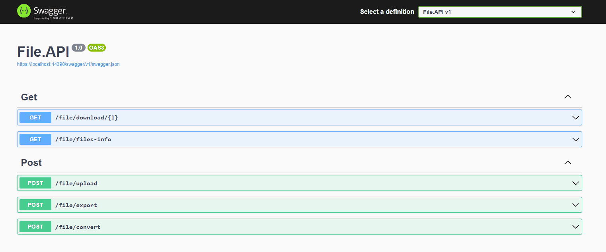

 

# Clean Architecture FileApi
[](https://github.com/Gramli/FileApi/actions/workflows/dotnet.yml)
[](https://github.com/Gramli/FileApi/actions/workflows/angular.yaml)
[](https://www.codacy.com/gh/Gramli/FileApi/dashboard?utm_source=github.com&amp;utm_medium=referral&amp;utm_content=Gramli/FileApi&amp;utm_campaign=Badge_Grade)
[](https://www.codacy.com/gh/Gramli/FileApi/dashboard?utm_source=github.com&utm_medium=referral&utm_content=Gramli/FileApi&utm_campaign=Badge_Coverage)

This full-stack solution allows for file uploads and downloads. The backend is a C# REST API, demonstrating how to create a clean, modern API using Clean Architecture, minimal APIs, and various design patterns. The frontend is an Angular project that demonstrates file upload and download functionality.

Example solution allows to **upload/download files with .txt, .json, .csv, .xml, .yml extensions** and get collection of uploaded files. Also allow to **convert between json, xml, yml formats**.

Two methods for downloading files are demonstrated:
* Using the **GetFileAsync** extension method, which returns the file as a byte array.
* Using the **GetJsonFileAsync** method, which returns the file inside a JSON object. The file is converted to a Base64 string to preserve encoding.

# Menu
- [Prerequisites](#prerequisites)
- [Installation](#installation)
- [Get Started](#get-started)
    - [Run Solution](#run-solution)
        - [Using PowerShell on Windows](#using-powershell-on-windows)
        - [Using Visual Studio](#using-visual-studio)
    - [Run only Backend](#run-only-backend)
- [Motivation](#motivation)
  - [Backend Architecture](#backend-architecture)
  - [Frontend Example](#frontend-example)
  - [Technologies](#technologies)

# Prerequisites

* **.NET SDK 10.0**
* **Node.js 24.21.0** and **npm 11.19.0**
* **Angular CLI 22.2.2** and **TypeScript 6.0.3** (installed with frontend dependencies)
* **Windows and PowerShell 5.1+** for `run.ps1`

# Installation

Clone the repository and navigate to its root directory:

1. Clone the repository:
   ```sh
   git clone https://github.com/Gramli/FileApi.git
   ```
2. Navigate to the project directory:
   ```sh
   cd FileApi
   ```

Choose a method below to run the solution. The PowerShell script restores backend dependencies and installs frontend dependencies as needed.

# Get Started

### Run Solution

#### Using PowerShell on Windows

Open PowerShell in the repository root. Before the first HTTPS launch, trust the ASP.NET Core development certificate under your Windows account:

```powershell
dotnet dev-certs https --trust
dotnet dev-certs https --check --trust
```

Accept the certificate trust prompt. The script does not trust certificates automatically; an untrusted certificate causes browser requests to fail with `ERR_CERT_AUTHORITY_INVALID`. See the [Microsoft development certificate documentation](https://learn.microsoft.com/en-us/dotnet/core/tools/dotnet-dev-certs).

Build and start both applications:

```powershell
.\run.ps1
```

The script builds the backend and frontend, then opens a separate command prompt for each service. It selects the backend's `https` launch profile by default. Frontend dependencies are reused until their configuration changes; the first run may reinstall an existing dependency folder to record its configuration.

Once both services are ready, open:

* Frontend: [http://127.0.0.1:4200](http://127.0.0.1:4200)
* API Swagger: [https://localhost:7270/swagger](https://localhost:7270/swagger)

Stop each service with **Ctrl+C** in its command prompt, or close the window. Stop existing instances before launching again to avoid port conflicts.

Common options:

| Command | Behavior |
| --- | --- |
| `.\run.ps1 -Watch` | Runs the backend with `dotnet watch`; the frontend development server also watches for changes. |
| `.\run.ps1 -BuildOnly` | Builds both applications without starting either service. |
| `.\run.ps1 -Restore` | Forces frontend dependency installation before building and starting both applications. |
| `.\run.ps1 -Configuration Release` | Builds and runs the backend in Release configuration; the frontend still uses its development server. |
| `.\run.ps1 -LaunchProfile https` | Explicitly selects the backend HTTPS launch profile. |

#### Using Visual Studio

Install the frontend dependencies from the repository root:

```powershell
npm --prefix src/File.Frontend ci
```

Open the solution in a Visual Studio version that supports .NET 10, then select the **"Run API and FE"** startup item. This starts both the API and the frontend servers. Accept the HTTPS development certificate trust prompt if shown.

### Run only Backend
Select the **"File.API"** startup item and try it. Or in case You need to edit Content Type, use Postman. [Example gif of how to change ContentType in Postman](doc/img/contentType.gif).



# Motivation
The main motivation is to create a practical example of a minimal API using Clean Architecture, while experimenting with libraries for validation and mapping, and to further improve my skills with Angular.

## Backend Architecture

Projects folows **[Clean Architecture](https://learn.microsoft.com/en-us/dotnet/architecture/modern-web-apps-azure/common-web-application-architectures#clean-architecture)**, but application layer is splitted to Core and Domain projects where Core project holds business rules and Domain project contains business entities.

As Minimal API allows to inject handlers into endpoint map methods, I decided to do not use **[MediatR](https://github.com/jbogard/MediatR)**, but still every endpoint has its own request and handler. Solution folows **[CQRS pattern](https://learn.microsoft.com/en-us/azure/architecture/patterns/cqrs)**, it means that handlers are separated by commands and queries, command handlers handle command requests and query handlers handle query requests. Also repositories (**[Repository pattern](https://learn.microsoft.com/en-us/aspnet/mvc/overview/older-versions/getting-started-with-ef-5-using-mvc-4/implementing-the-repository-and-unit-of-work-patterns-in-an-asp-net-mvc-application)**) are separated by command and queries.

Instead of throwing exceptions, project use **[Result pattern](https://www.forevolve.com/en/articles/2018/03/19/operation-result/)** (using [FluentResuls package](https://github.com/altmann/FluentResults)) and for returning exact http response, every handler returns data wraped into HttpDataResponse object which contains also error messages collection and http response code.

Important part of every project are **[tests](https://github.com/Gramli/WeatherApi/tree/main/src/Tests)**. When writing tests we want to achieve [optimal code coverage](https://stackoverflow.com/questions/90002/what-is-a-reasonable-code-coverage-for-unit-tests-and-why). I think that every project has its own optimal code coverage number by it's need and I always follow the rule: **cover your code to be able refactor without worry about functionality change**.

In this solution, each 'code' project has its own unit test project and every **unit test** project copy the same directory structure as 'code' project, which is very helpful for orientation in test project. Infrastructure project has also **integration tests**, because for format conversion is used third party library and we want to know that conversion works always as expected (for example when we update library version).

## Frontend Example
The frontend is a simple Angular project that demonstrates how to upload and download files as blobs or FormData from the C# API. Files are saved to the Downloads folder using the [file-saver](https://www.npmjs.com/package/file-saver) library. For styling, the project utilizes [Bootstrap](https://getbootstrap.com/). It also includes examples of displaying modals with [ng-bootstrap](https://www.npmjs.com/package/@ng-bootstrap/ng-bootstrap) and showing toasts/notifications with [angular-notifier](https://www.npmjs.com/package/gramli-angular-notifier). Additionally, it demonstrates how to use translations in an Angular project with the [@ngx-translate/core](https://ngx-translate.org/) library, including a custom implementation of TranslateLoader to handle multiple translation files.

## Technologies

Frontend package versions below reflect [`package-lock.json`](src/File.Frontend/package-lock.json). Backend package versions are managed in [`Directory.Packages.props`](src/Directory.Packages.props).

| Technology | Project version |
| --- | --- |
| .NET / [ASP.NET Core](https://learn.microsoft.com/en-us/aspnet/core/introduction-to-aspnet-core?view=aspnetcore-10.0) | 10.0 |
| [Angular](https://angular.dev) / Angular CLI | 22.2.2 |

Backend libraries:

* [Entity Framework Core InMemory](https://learn.microsoft.com/en-us/ef/core/providers/in-memory/?tabs=dotnet-core-cli) 10.0.0
* [SmallApiToolkit](https://github.com/Gramli/SmallApiToolkit) 10.0.0
* [Mapster](https://github.com/MapsterMapper/Mapster) 7.4.0
* [FluentResults](https://github.com/altmann/FluentResults) 3.16.0
* [Validot](https://github.com/bartoszlenar/Validot) 2.6.0
* [GuardClauses](https://github.com/ardalis/GuardClauses) 5.0.0
* [Moq](https://github.com/moq/moq4) 4.20.72
* [xUnit](https://github.com/xunit/xunit) 2.9.3
* [ChoETL.Yaml](https://github.com/Cinchoo/ChoETL) 1.0.0.38
